# Hospes POS – korisničko uputstvo

Proizvođač: OmniIT · Proizvod: Hospes POS · Verzija softvera: 0.0.1 · ESIR broj: 1795/0.0.1

Slike u ovom uputstvu su napravljene na razvojnom okruženju Poreske uprave. Poreske oznake i stope na njima
(npr. „A 10%“) su probne; u radu se koriste samo oznake i stope koje vrati PFR.

## 1. Uvod

Hospes POS je elektronski sistem za izdavanje računa (ESIR). Kasir u njemu sastavlja račun, a Hospes POS ga šalje
procesoru fiskalnih računa (PFR): lokalnom (L-PFR) ili virtuelnom PFR-u Poreske uprave (V-PFR). Fiskalni račun koji
PFR vrati Hospes POS upisuje u elektronski žurnal i štampa.

Pravila koja Hospes POS uvek poštuje:

- Račun se ne izdaje ako PFR nije vratio sve potrebne podatke.
- Svi podaci fiskalnog računa koje vrati PFR (zaglavlje sa podacima obveznika, stavke, porezi, PFR vreme, PFR broj,
  brojač, QR kod) prikazuju se i štampaju onako kako ih je PFR vratio; Hospes POS ih ne menja i ne izostavlja.
- Koriste se samo poreske oznake i stope koje vrati PFR.
- Fiskalni račun se štampa jednom, odmah posle izdavanja. Drugi primerak je uvek račun vrste Kopija (6.2).

## 2. Ekran

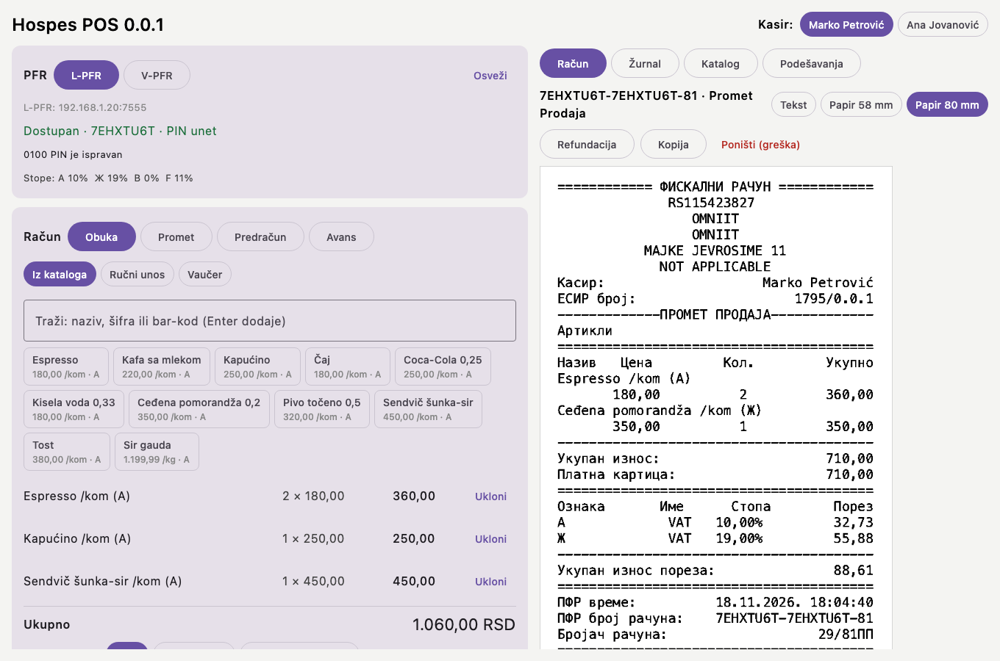

- **Gore:** naziv i verzija programa i izbor kasira.
- **Levo gore, PFR:** izbor L-PFR ili V-PFR, stanje PFR-a („Dostupan“), šifre stanja i poreske stope.
- **Levo, Račun:** račun koji se pravi: vrsta računa, stavke, ukupno, plaćanje, kupac i dugme „Izdaj račun“.
- **Desno, kartice:**
  - **Račun:** izdati ili izabrani račun, kao tekst ili kao otisak na papiru 58 mm ili 80 mm, i radnje nad njim;
  - **Žurnal:** svi izdati računi, sa pretragom;
  - **Katalog:** artikli;
  - **Podešavanja:** podešavanja kase (vidi Uputstvo za konfiguraciju).

## 3. Početak rada

### 3.1 Kasir

Gore desno kasir izabere svoje ime. Ime izabranog kasira štampa se na svakom računu (Касир). Dok kasir nije izabran,
račun se ne izdaje. Kasiri se dodaju u Podešavanjima.

### 3.2 Veza sa PFR-om

Pri pokretanju Hospes POS proverava PFR. Kada je sve u redu, piše **„Dostupan“**, kao i poreske stope koje je vratio
PFR. Dugme **„Osveži“** ponovo proverava PFR. L-PFR i Hospes POS se međusobno proveravaju preko PIN-a bezbednosnog
elementa, a V-PFR i Hospes POS preko digitalnog sertifikata.

### 3.3 PIN

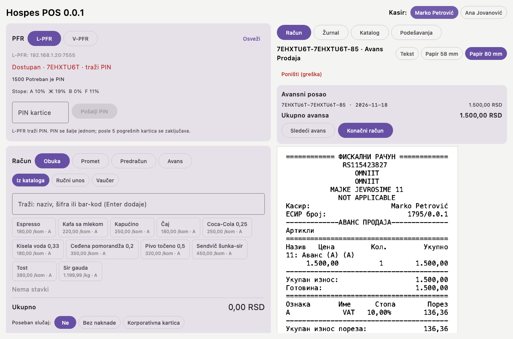

Kada L-PFR traži PIN (šifra stanja 1500), pojavi se polje **„PIN kartice“**. Kasir upisuje PIN (4 cifre) i klikne
„Pošalji PIN“. PIN se šalje jednom; ako nije prihvaćen, Hospes POS ga ne šalje ponovo sam, jer se posle 5 pogrešnih
unosa kartica zaključava. PIN se ne čuva.

## 4. Izdavanje računa

### 4.1 Vrsta računa

Iznad stavki se bira vrsta računa: **Obuka**, **Promet**, **Predračun** ili **Avans** (tip transakcije Prodaja).
Refundacija i Kopija se izdaju za već izdat račun iz žurnala (poglavlje 6). Na računima vrste Kopija, Predračun i
Obuka štampa se „ОВО НИЈЕ ФИСКАЛНИ РАЧУН“, slovima najmanje dvostruko većim od ostalog teksta.

### 4.2 Stavke iz kataloga

Klik na artikal ga dodaje na račun; ponovni klik povećava količinu. Polje **„Traži“** pronalazi artikal po nazivu,
šifri ili bar-kodu (GTIN). Čitač bar-koda upisuje kod u to polje i šalje Enter, pa se artikal odmah dodaje.

### 4.3 Ručni unos stavke

U kartici **„Ručni unos“** upisuju se naziv, količina, cena, popust u procentima i bira se poreska oznaka (samo oznake
koje je vratio PFR). Jedinica mere je deo naziva, odvojena kosom crtom, npr. „Sir /kg“. Količina može da ima do 3
decimale, cena do 2. Cena posle popusta i iznos stavke zaokružuju se na 2 decimale (polovina naviše).

### 4.4 Izmena i uklanjanje stavke

Dok račun nije izdat, stavka se uklanja dugmetom **„Ukloni“**. Cena se menja ručnim unosom stavke ili izmenom cene
u katalogu (poglavlje 9).

### 4.5 Plaćanje

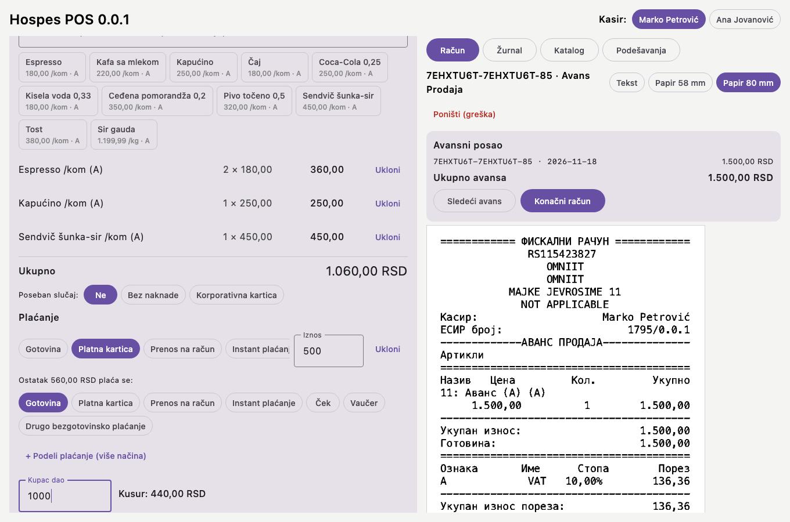

- Način plaćanja: Gotovina, Platna kartica, Prenos na račun, Instant plaćanje, Ček, Vaučer ili Drugo bezgotovinsko
  plaćanje.
- **Podeljeno plaćanje:** „+ Podeli plaćanje (više načina)“ dodaje deo sa iznosom (npr. 500 karticom); ostatak se
  plaća izabranim glavnim načinom. Delova može biti više.
- **Gotovina:** u polje „Kupac dao“ upisuje se primljeni iznos; prikazuje se kusur. PFR-u se kao gotovina šalje iznos
  koji ostaje u kasi, a kusur se štampa ispod računa („Повраћај“).
- Ako je kasa podešena bez kartice, čeka i instanta (Pravilnik, član 6, stav 2), ta tri načina se ne nude, a kasir ih
  unosi kao gotovinu.

### 4.6 Kupac

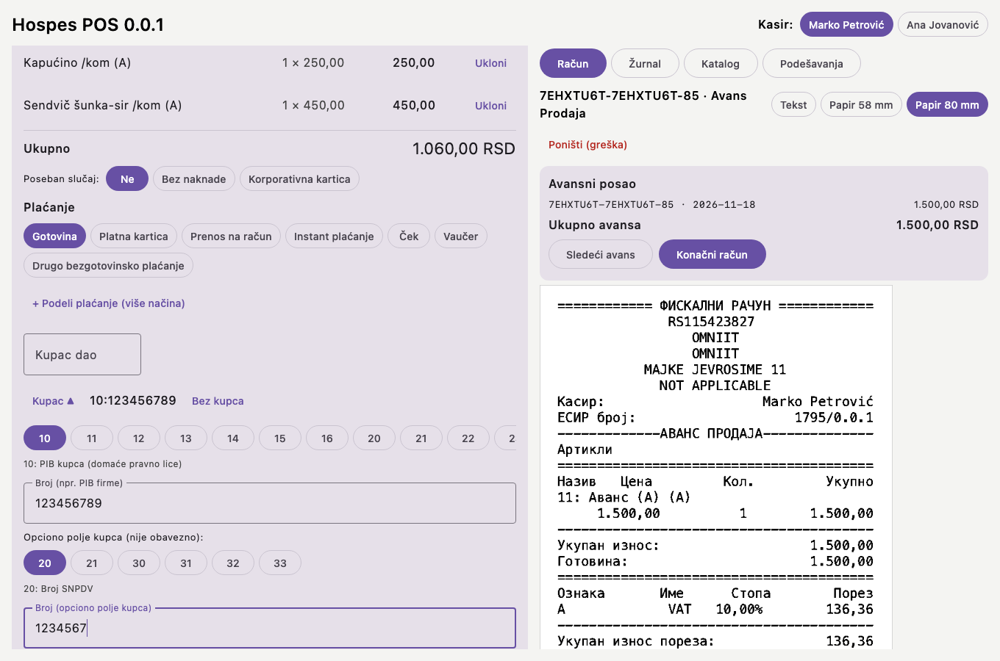

„Kupac (na firmu, PIB…)“ otvara unos kupca: šifra po šifarniku (npr. 10 = PIB, 9 cifara; 11 = JMBG, 13 cifara;
20 = broj lične karte) i broj. Ispod je **opciono polje kupca** (šifre 20, 21, 30–33). Kupac važi samo za račun koji se
izdaje. Na računu se štampaju „ИД купца“ i „Опционо поље купца“.

### 4.7 Izdavanje i šta piše na računu

Dugme **„Izdaj račun“** šalje račun PFR-u. Kada PFR vrati fiskalni račun, Hospes POS ga upisuje u elektronski žurnal,
prikazuje desno i štampa. Račun sadrži:

1. naslovnu liniju „ФИСКАЛНИ РАЧУН“ (ili „ОВО НИЈЕ ФИСКАЛНИ РАЧУН“);
2. zaglavlje sa PIB-om, nazivom i adresom obveznika, kako ga vrati PFR;
3. kasira, ID kupca i opciono polje kupca (kada postoje), ЕСИР број (`1795/0.0.1`) i, kod avansa uplaćenog ranije,
   ЕСИР време;
4. Реф. број i Реф. време kod Kopije, Refundacije i računa koji se poziva na drugi račun;
5. vrstu računa i tip transakcije (npr. „ПРОМЕТ ПРОДАЈА“);
6. artikle: naziv sa jedinicom mere i poreskom oznakom, jediničnu cenu, količinu i ukupno;
7. ukupan iznos, načine plaćanja, poreske stavke po oznakama i ukupan iznos poreza;
8. PFR vreme, PFR broj računa i brojač računa;
9. QR kod za proveru računa (40–50 mm);
10. naslovnu liniju „КРАЈ ФИСКАЛНОГ РАЧУНА“; ispod nje: kusur, podatke koje dodaje Hospes POS (npr. kod avansa) i
    tekst ispod računa (polje za reklamu).

Ako veza sa PFR-om pukne usred slanja, Hospes POS proverava kod PFR-a da li je račun izdat (po RequestId). Ako ne može
da utvrdi, prikazuje poruku „NE ZNA SE da li je račun izdat“: tada se račun ne izdaje ponovo pre provere.

## 5. Elektronski žurnal

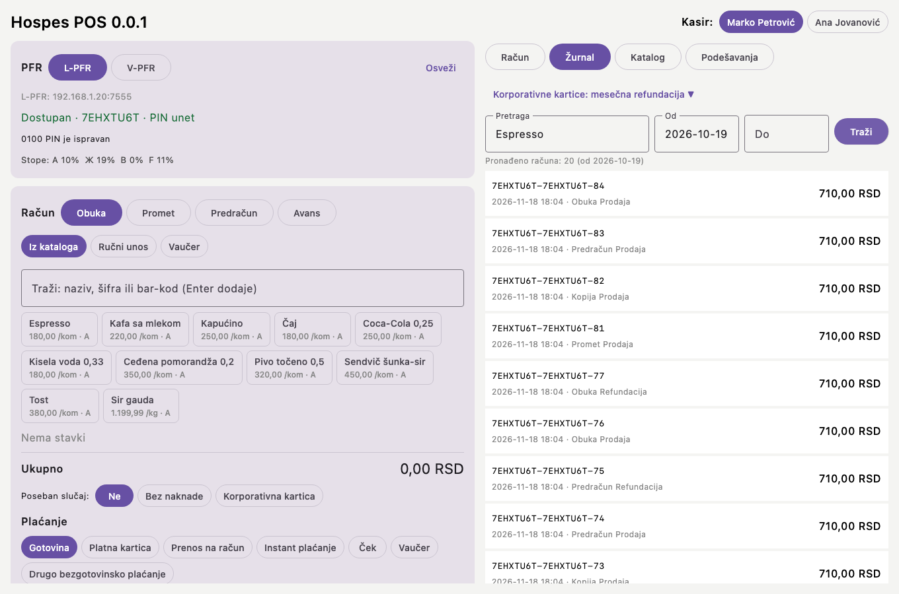

Kartica **„Žurnal“** prikazuje izdate račune, od najnovijeg. Polje **„Pretraga“** traži po broju računa, nazivu
artikla, kupcu ili kasiru, a polja „Od“ i „Do“ ograničavaju period (format gggg-mm-dd; bez perioda: poslednjih
30 dana). Klik na račun prikazuje ga u kartici „Račun“, kao **tekst** ili kao **otisak na papiru 58 mm ili 80 mm**.

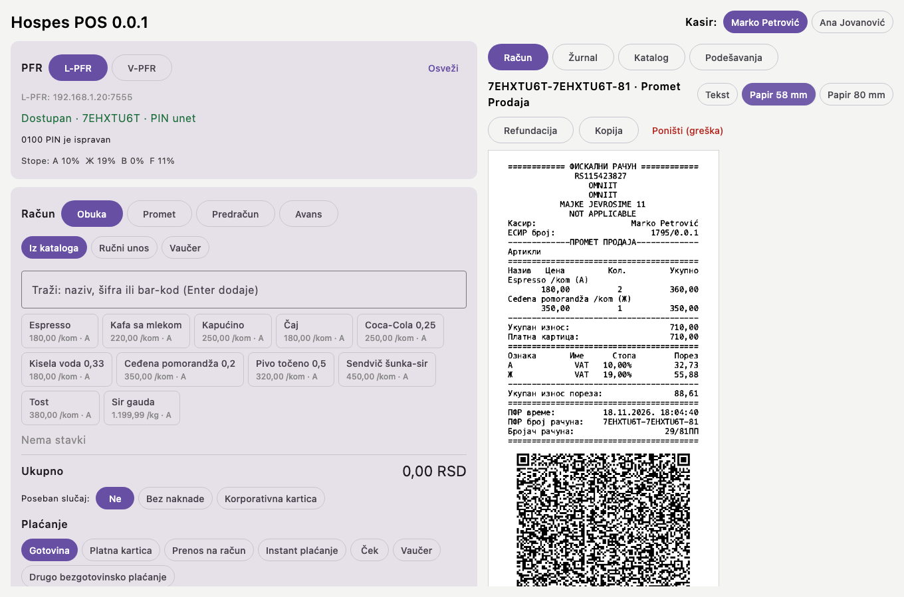

Svi računi ostaju sačuvani u folderu podataka kase (vidi Uputstvo za instalaciju, poglavlje 4).

## 6. Radnje nad izdatim računom

U kartici „Račun“, ispod broja računa, prikazuju se radnje koje su za taj račun dozvoljene.

### 6.1 Refundacija

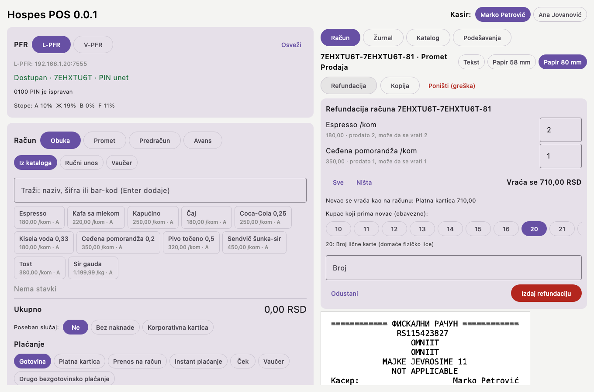

„Refundacija“ (za Promet, Obuku i Predračun, tip Prodaja) otvara panel: stavke sa količinama koje se vraćaju
(unapred sve što je ostalo, može i deo), način povraćaja novca i **ID kupca koji prima novac** (obavezan). Hospes POS
sam popunjava Реф. број (broj računa koji se refundira). Ne može se vratiti više nego što je prodato, ni kroz više
refundacija. Kada se kod računa vrste Promet vraća **gotovina**, odmah se izdaje i **Kopija Refundacije** sa redom za
potpis kupca: kupac je potpisuje i ona ostaje u radnji.

### 6.2 Kopija

„Kopija“ (za račun vrste Promet, prodaje ili refundacije) izdaje račun vrste Kopija sa istim stavkama, plaćanjima i
kupcem i Реф. brojem originala. Traži potvrdu („Da, izdaj kopiju“).

### 6.3 Naplata po predračunu

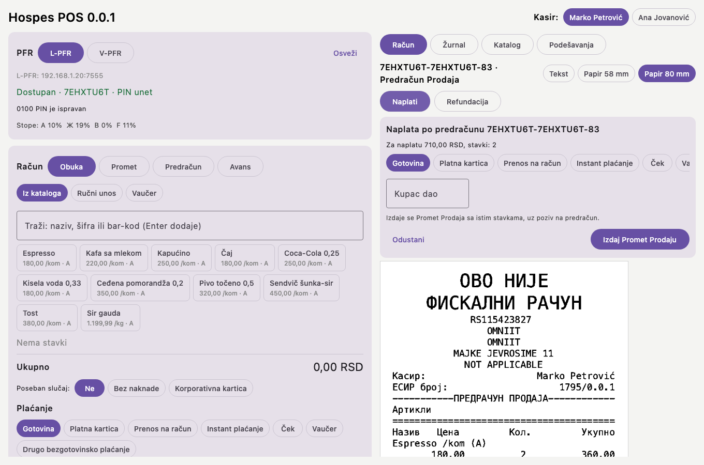

Na predračunu, **„Naplati“** izdaje Promet Prodaju sa istim stavkama i pozivom na predračun. Bira se način plaćanja
(kod gotovine i kusur). Predračun se naplaćuje jednom.

### 6.4 Poništavanje računa sa greškom

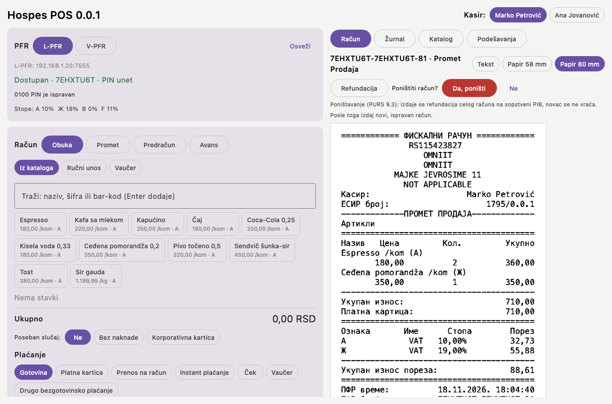

**„Poništi (greška)“** (Promet Prodaja ili Avans Prodaja) izdaje refundaciju celog računa sa sopstvenim PIB-om
obveznika u polju ID kupca (PURS tehničko uputstvo, 9.3). Novac se ne vraća. Posle toga se izdaje novi, ispravan
račun. Račun koji je već refundiran ne može se poništiti.

## 7. Avansi

### 7.1 Prvi avans

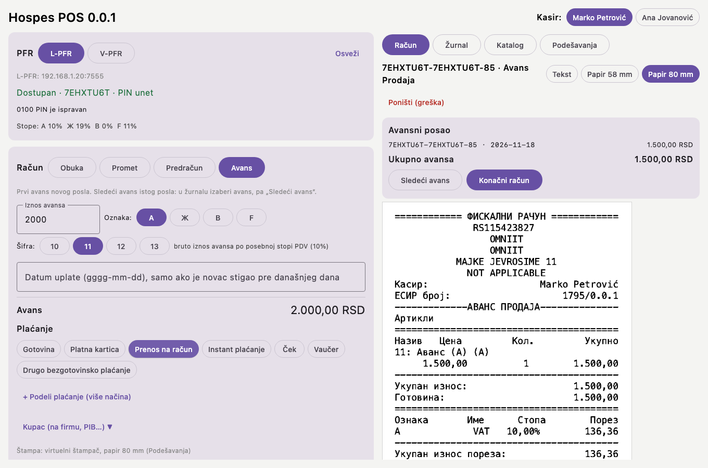

Vrsta računa **„Avans“**: upisuje se iznos avansa i bira poreska oznaka. **Šifra avansa** se bira sama po stopi
(20% → 10, 10% → 11, 0% → 12), a šifra 13 (obveznik van sistema PDV-a) bira se ručno. Na računu stavka glasi npr.
„11: Аванс (Е)“. Ako je novac (npr. virmanom) stigao pre današnjeg dana, upisuje se **datum uplate**: na računu se
tada štampa „ЕСИР време“ (PURS 9.2). Kupca je najbolje upisati već na prvom avansu.

### 7.2 Sledeći avans

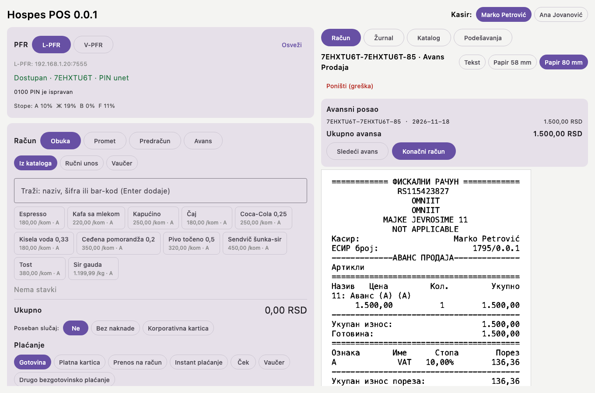

Kada se u žurnalu izabere avans, desno se prikazuje **„Avansni posao“**: svi avansi tog posla i njihov zbir.
„Sledeći avans“ priprema novi avans koji se poziva na poslednji (Реф. број), sa istim kupcem i oznakom.

### 7.3 Konačni račun

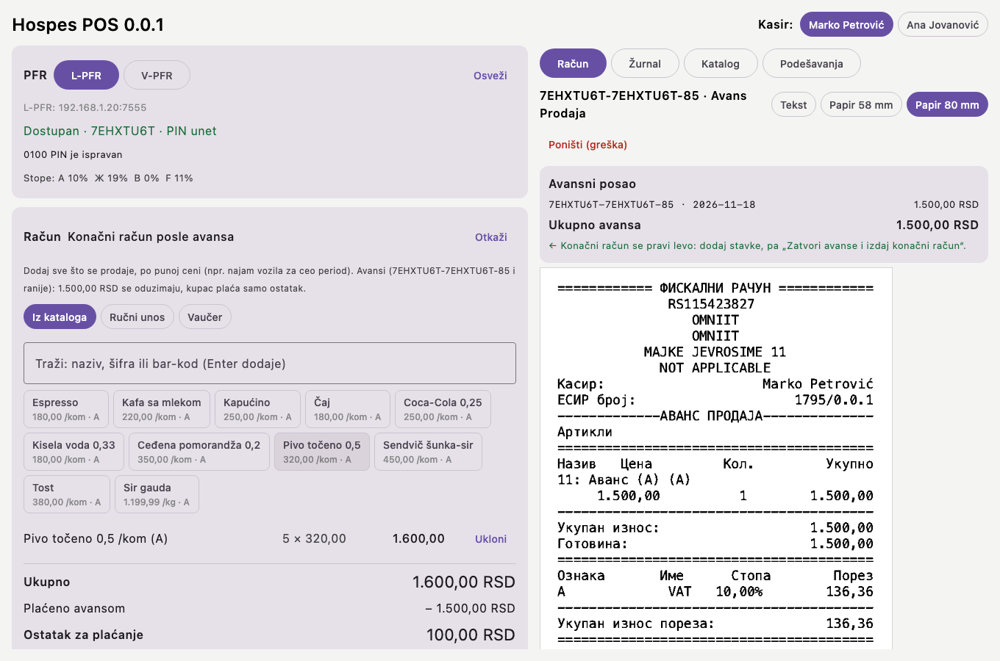

„Konačni račun“ prebacuje levu stranu u režim konačnog računa. Dodaju se sve stavke koje se prodaju, **po punoj ceni**;
prikazuju se ukupno, plaćeno avansom i ostatak za plaćanje. Ako na avansima nema kupca, unosi se ovde (obavezan je).
Dugme „Zatvori avanse i izdaj konačni račun“ izdaje:

1. **Avans Refundaciju** za zbir svih avansa, sa pozivom na poslednji avans (ne daje se kupcu);
2. **Promet Prodaju** sa svim stavkama i pozivom na Avans Refundaciju; kao plaćanje PFR-u ide samo ostatak.

Ispod konačnog računa štampaju se „Плаћено авансом“, „ПДВ на аванс“, „Преостало за плаћање“ i broj i datum
poslednjeg avansnog računa. Avansni posao se zatvara jednom; zatvoren posao ne prima nove avanse.

## 8. Posebni slučajevi

### 8.1 Promet bez naknade

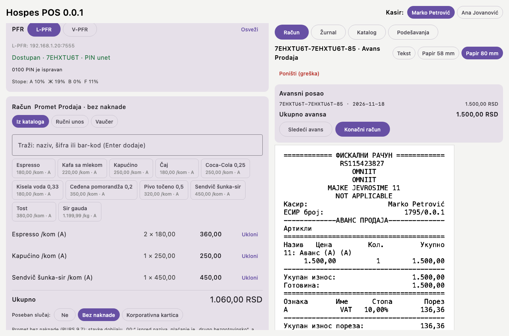

„Poseban slučaj: Bez naknade“ (PURS 9.7): stavke dobijaju oznaku „00:“ ispred naziva, plaćanje je „Drugo
bezgotovinsko plaćanje“, a ispod računa se štampa „*Промет без накнаде“. Izdaje se Promet Prodaja.

### 8.2 Korporativna kartica

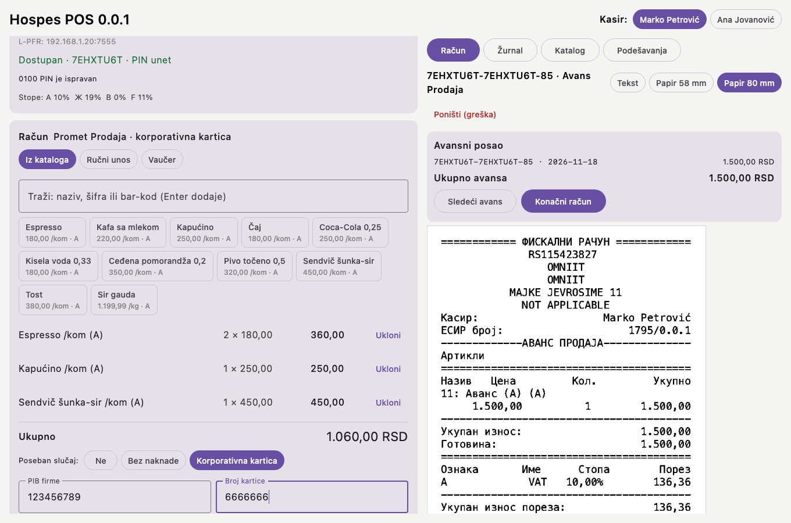

„Poseban slučaj: Korporativna kartica“ (PURS 9.4): upisuju se PIB firme i broj kartice; plaćanje je uvek vaučer.
Jednom mesečno se u žurnalu izdaje zbirna refundacija: „Korporativne kartice: mesečna refundacija“, PIB firme i mesec.
Prikazuje se koliko računa i koji iznos ulaze u nju. Za istu firmu i mesec izdaje se jednom, a računi koje obuhvata
više se ne refundiraju ni ne poništavaju pojedinačno.

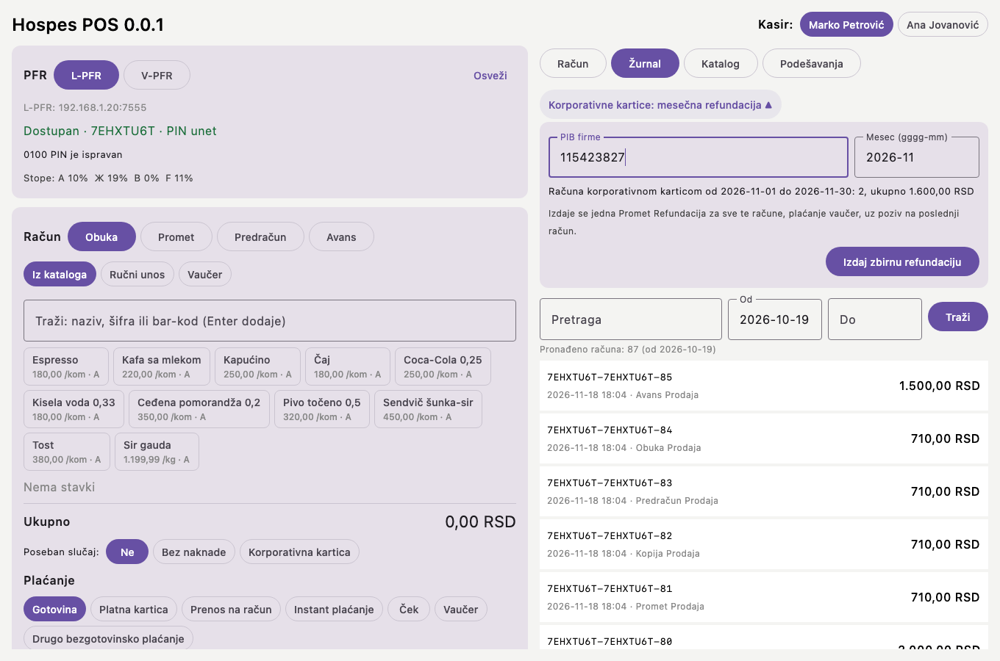

### 8.3 Jednonamenski vaučer

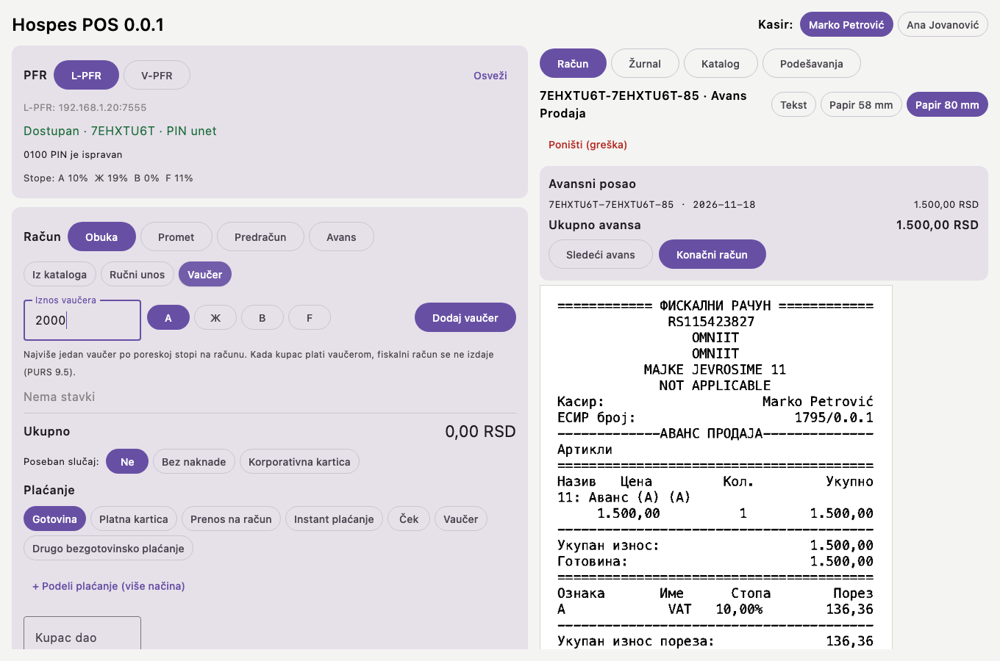

Kartica **„Vaučer“** (PURS 9.5): iznos i poreska oznaka dodaju stavku „20: Једнонаменски ваучер (oznaka)“. Na računu
može biti najviše jedan vaučer po poreskoj stopi. Kada kupac plati jednonamenskim vaučerom, fiskalni račun se ne
izdaje.

## 9. Katalog artikala

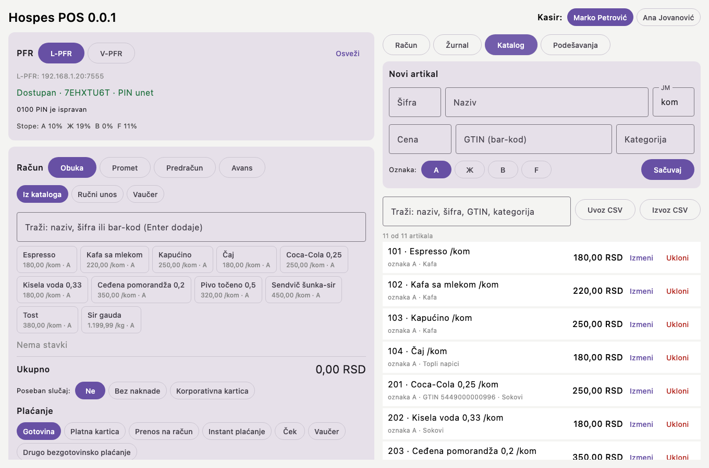

U kartici **„Katalog“** korisnik sam unosi i menja artikle:

- **Novi artikal:** šifra, naziv, jedinica mere, cena (do 2 decimale), poreska oznaka (iz PFR-a), GTIN (bar-kod, sa
  proverom kontrolne cifre) i kategorija; „Sačuvaj“.
- **Promena cene:** „Izmeni“ pored artikla, nova cena, „Sačuvaj“.
- **Pretraga:** po nazivu, šifri, GTIN-u ili kategoriji.
- **Uvoz i izvoz:** „Uvoz CSV“ i „Izvoz CSV“ (fajl za Excel; kolone su opisane u Uputstvu za konfiguraciju,
  poglavlje 10).

## 10. Poreske stope

Poreske stope dolaze isključivo od PFR-a i prikazuju se u delu PFR (npr. „Stope: A 10% Ж 19% …“); „Osveži“ ih ponovo
preuzima. Poreska oznaka stavke bira se samo među oznakama koje je vratio PFR. Porez po oznakama i ukupan porez
izračunava PFR i oni se štampaju onako kako ih je PFR vratio. Ako stavka ima oznaku koju PFR više ne vraća, Hospes POS
je ne dodaje na račun.

## 11. Poruke

| Poruka | Šta znači i šta uraditi |
|---|---|
| „PFR se ne javlja“ | nema veze sa PFR-om: proverite mrežu ili internet, pa „Osveži“ |
| „traži PIN“ | kasir unosi PIN (3.3) |
| „Izaberi kasira“ / „Dodaj kasira u Podešavanjima“ | izaberite kasira gore desno (3.1) |
| „… je odbio račun“ | PFR nije prihvatio račun; ispisane su šifre i opis greške |
| „NE ZNA SE da li je račun izdat“ | veza je pukla; ne izdavati ponovo pre provere u žurnalu |
| „… JE izdat …, ali štampa nije uspela“ | račun je izdat i u žurnalu je; ne izdaje se ponovo |
