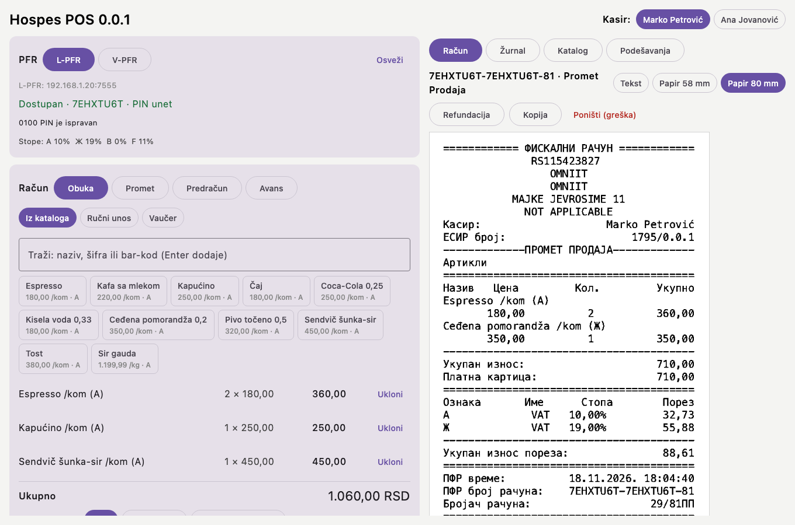

# Hospes POS – opis proizvoda

Proizvođač: OmniIT · Proizvod: Hospes POS · Verzija softvera: 0.0.1 · ESIR broj: 1795/0.0.1

## 1. Šta je Hospes POS

Hospes POS je softverski **elektronski sistem za izdavanje računa (ESIR)** za računare sa operativnim sistemom
Windows. Kasir u njemu sastavlja račun (artikli, količine, cene, popusti, način plaćanja, kupac), a Hospes POS
račun šalje **procesoru fiskalnih računa (PFR)**: lokalnom (L-PFR) ili virtuelnom PFR-u Poreske uprave (V-PFR).
Fiskalni račun koji PFR vrati Hospes POS čuva u elektronskom žurnalu i štampa, sa QR kodom za proveru.

Hospes POS je **Napredni ESIR**: izdaje sve vrste računa (Promet, Predračun, Kopija, Obuka, Avans) i oba tipa
transakcije (Prodaja, Refundacija), uključujući ceo tok avansnog plaćanja.

## 2. Kome je namenjen

- **Ugostiteljstvo** (kafići, restorani): brza prodaja iz kataloga, predračun za sto pa naplata, gratis i
  reprezentacija (promet bez naknade), delimična refundacija („gost je vratio jedno piće“).
- **Rent-a-car i usluge sa uplatom unapred**: avansi (prvi i sledeći), uplata virmanom od ranijeg datuma,
  konačni račun na kome se plaća samo ostatak.
- **Maloprodaja**: katalog sa bar-kodovima (GTIN), čitač bar-koda, uvoz i izvoz cenovnika iz Excel-a.

## 3. Glavne funkcije

| Oblast | Šta Hospes POS radi |
|---|---|
| Računi | Promet, Predračun, Obuka, Avans (prodaja); Refundacija i Kopija izdatih računa; poziv na broj (Реф. број) se popunjava sam |
| Stavke | katalog artikala, pretraga po nazivu, šifri i bar-kodu (GTIN), ručni unos, količina do 3 decimale, popust, uklanjanje stavke pre izdavanja |
| Plaćanje | svih 7 načina (gotovina, platna kartica, prenos na račun, instant, ček, vaučer, drugo bezgotovinsko), podeljeno plaćanje, kusur; podešavanje za obveznike bez kartice, čeka i instanta (Pravilnik, član 6, stav 2) |
| Kupac | ID kupca po šifarniku (PIB, JMBG, lična karta, pasoš…) i opciono polje kupca, sa proverom formata |
| Refundacija | cela ili delimična, uz ID kupca; posle povraćaja gotovine kopija sa redom za potpis kupca; zaštita od dvostrukog povraćaja |
| Posebni slučajevi | poništavanje računa sa greškom, promet bez naknade, korporativna kartica i mesečna zbirna refundacija, jednonamenski vaučer, avansi (PURS tehničko uputstvo, poglavlje 9) |
| Elektronski žurnal | svi izdati računi, pretraga po broju računa, artiklu, kupcu, kasiru i periodu, prikaz računa kao teksta i kao otiska |
| Poreske stope | samo stope koje vrati PFR; prikaz stopa u svakom trenutku |
| Bezbednost | PIN se unosi na ekranu i šalje jednom; sertifikat, lozinka i PAC za V-PFR su skriveni na ekranu; zaštita od dvostrukog izdavanja računa kada pukne veza (provera po RequestId) |
| Štampa | otisak za papir 57/58 mm i 80 mm, QR kod 40–50 mm, „ОВО НИЈЕ ФИСКАЛНИ РАЧУН“ duplo većim slovima, tekst ispod računa (polje za reklamu) |

## 4. Tehnički podaci

| | |
|---|---|
| Tip ESIR-a | softver na računaru (POS) |
| Klasifikacija | Napredni ESIR |
| Operativni sistem | Windows 10 i Windows 11 (64-bit) |
| Instalacija | instalacioni paket `.msi` sa ugrađenim Java okruženjem; direktno u poslovnom prostoru ili samoinstalacija |
| Podržani PFR | L-PFR (HTTP) i V-PFR sa digitalnim sertifikatom u fajlu (HTTPS, sertifikat i PAC) |
| Protokol sa PFR-om | TaxCore API v3, po Tehničkom vodiču Poreske uprave |
| Povezivanje | Ethernet, Wi-Fi, mobilna mreža |
| Papir | rolna 57/58 mm i 80 mm (termalni štampač) |
| Dostavljanje računa | u papirnoj formi |
| ESIR broj na računu | `1795/0.0.1` (ИБ број/verzija softvera) |

## 5. Dokumentacija

- Korisničko uputstvo za proizvod (kasir).
- Uputstvo za instalaciju.
- Uputstvo za konfiguraciju.

## 6. Proizvođač i kontakt

| | |
|---|---|
| Proizvođač | OmniIT |
| PIB | 115423827 |
| Adresa | |
| Telefon | |
| E-pošta | |
| Internet stranica | |
