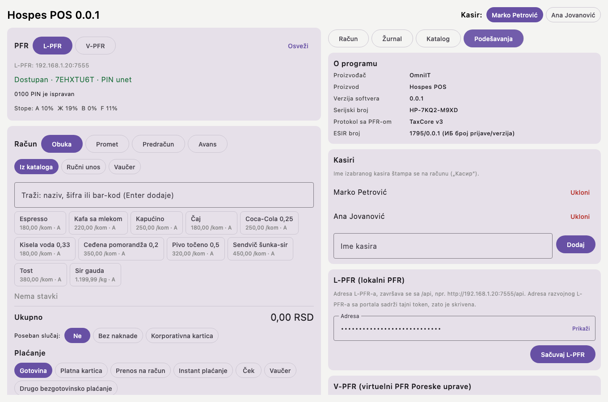
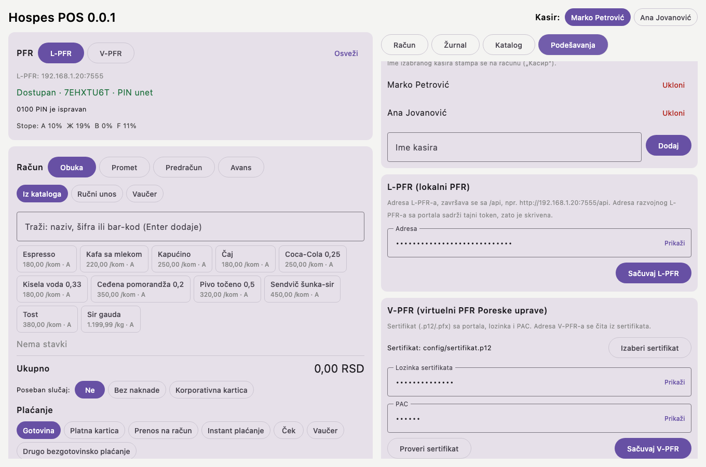
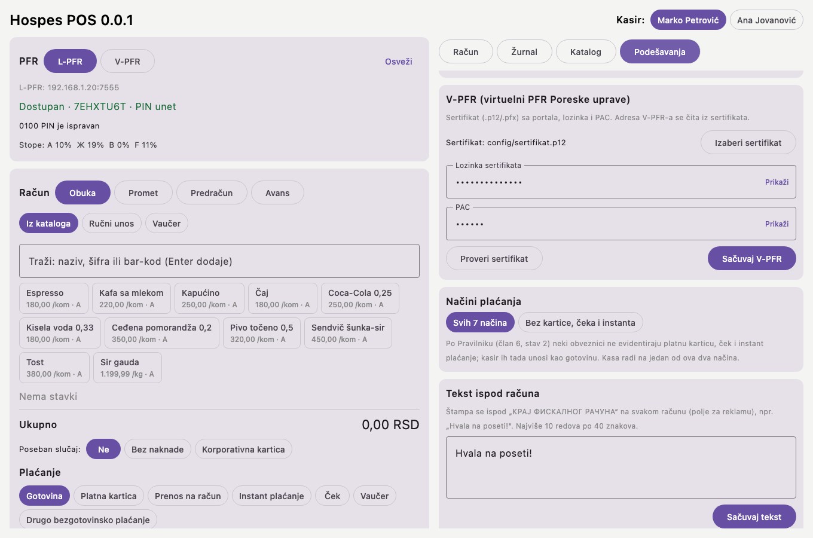

# Hospes POS – uputstvo za konfiguraciju

Proizvođač: OmniIT · Proizvod: Hospes POS · Verzija softvera: 0.0.1 · ESIR broj: 1795/0.0.1

Sva podešavanja kase su u kartici **„Podešavanja“** (desno). Čuvaju se odmah, na računaru kase, u fajlu
`%APPDATA%\Hospes ESIR\config\local.json`. Pri prvom pokretanju, dok nijedan PFR nije podešen, Hospes POS sam otvara
ovu karticu.

## 1. Pregled



Kartica ima delove: O programu, Kasiri, L-PFR, V-PFR, Načini plaćanja, Tekst ispod računa i Štampač. Na dnu je putanja
foldera sa podacima kase.

## 2. O programu

Prikazuje proizvođača (OmniIT), proizvod (Hospes POS), verziju softvera (0.0.1), **serijski broj** instalacije
(dodeljuje se pri prvom pokretanju, npr. `HP-7KQ2-M9XD`), protokol sa PFR-om (TaxCore v3) i **ESIR broj**
(`1795/0.0.1`, ИБ број prijave/verzija softvera), koji se štampa na svakom računu.

## 3. Kasiri

Upišite ime kasira i kliknite „Dodaj“; „Ukloni“ briše kasira sa spiska. Ime izabranog kasira štampa se na svakom
računu (Касир). Ime može da ima najviše 50 znakova. Ako je kasir samo jedan, izabran je odmah; ako ih je više, kasir
se bira gore desno na početku smene.

## 4. L-PFR

Upišite adresu L-PFR-a, koja se završava sa `/api` (npr. `http://192.168.1.20:7555/api`), i kliknite
„Sačuvaj L-PFR“. Adresa je na ekranu skrivena, jer adresa razvojnog L-PFR-a sadrži tajni token; „Prikaži“ je
otkriva. Hospes POS sa L-PFR-om radi preko HTTP protokola, po Tehničkom vodiču Poreske uprave.

## 5. V-PFR



1. **„Izaberi sertifikat“**: izaberite fajl sertifikata sa portala Poreske uprave (`.p12` ili `.pfx`). Fajl se
   kopira u folder podataka kase (`config\`).
2. Upišite **lozinku sertifikata** i **PAC**. Oba polja su skrivena; „Prikaži“ ih otkriva.
3. **„Proveri sertifikat“** prikazuje UID, PIB, adresu V-PFR-a i rok važenja sertifikata. Adresa V-PFR-a se čita iz
   sertifikata.
4. **„Sačuvaj V-PFR“**.

Hospes POS sa V-PFR-om radi preko HTTPS protokola, sa sertifikatom kao potvrdom identiteta.

## 6. Izbor PFR-a, provera veze i PIN

U delu PFR (levo gore) izaberite **L-PFR** ili **V-PFR**; izbor se pamti. „Osveži“ proverava vezu: treba da piše
„Dostupan“, uz šifre stanja i poreske stope koje je vratio PFR. Ako L-PFR traži PIN, kasir ga unosi na ekranu
(Korisničko uputstvo, 3.3). V-PFR nema PIN.

## 7. Načini plaćanja



- **„Svih 7 načina“** (podrazumevano): gotovina, platna kartica, prenos na račun, instant plaćanje, ček, vaučer, drugo
  bezgotovinsko plaćanje.
- **„Bez kartice, čeka i instanta“**: za obveznike koji po Pravilniku (član 6, stav 2) ne evidentiraju platnu karticu,
  ček i instant plaćanje; ta tri načina se tada ne nude, a kasir ih unosi kao gotovinu.

Kasa radi samo na jedan od ova dva načina.

## 8. Tekst ispod računa

Tekst koji se štampa ispod „КРАЈ ФИСКАЛНОГ РАЧУНА“ na svakom računu (polje za reklamu), npr. „Hvala na poseti!“.
Najviše 10 redova po 40 znakova. „Sačuvaj tekst“ ga čuva.

## 9. Štampač i papir

U delu „Štampač“ bira se širina papira: **58 mm** ili **80 mm**. Na papiru 58 mm štampa se 48 mm (384 tačke), a na
papiru 80 mm 72 mm (576 tačaka), u 40 znakova po redu. QR kod se štampa u veličini od 40 do 50 mm.

**[DOPUNITI: povezivanje termalnog štampača (USB, mreža), kada se poveže štampač.]** U ovoj verziji Hospes POS svaki
račun upisuje i kao sliku otiska i ESC/POS podatke za štampač u folder `stampa\` u folderu podataka kase.

## 10. Katalog: CSV fajl za uvoz

Katalog se može pripremiti u Excel-u i uvesti („Katalog“ → „Uvoz CSV“). Prvi red su nazivi kolona, razdvojeni
tačkom-zarezom:

```
sifra;naziv;jedinica_mere;cena;oznaka;gtin;kategorija
101;Espresso;kom;180,00;A;;Kafa
201;Coca-Cola 0,25;kom;250,00;A;5449000000996;Sokovi
```

| Kolona | Obavezna | Opis |
|---|---|---|
| `sifra` | da | 1–20 slova, cifara, crtica ili tačaka; jedinstvena |
| `naziv` | da | naziv artikla |
| `jedinica_mere` | ne | npr. kom, kg, l (podrazumevano kom) |
| `cena` | da | do 2 decimale, decimalni zarez (npr. `1199,99`) |
| `oznaka` | da | poreska oznaka koju vraća PFR |
| `gtin` | ne | bar-kod: 8, 12, 13 ili 14 cifara, sa ispravnom kontrolnom cifrom |
| `kategorija` | ne | npr. Kafa, Sokovi |

Fajl može biti sačuvan kao „CSV UTF-8“ ili kao običan „CSV“ iz Excel-a. Neispravni redovi se preskaču, a Hospes POS
ispiše koji red i zašto. „Izvoz CSV“ pravi isti format.

## 11. Podaci kase

Svi podaci kase (podešavanja, sertifikat, elektronski žurnal, katalog, otisci, `greske.log`) su u folderu
`%APPDATA%\Hospes ESIR`. Opis foldera i rezervne kopije: Uputstvo za instalaciju, poglavlje 4.
